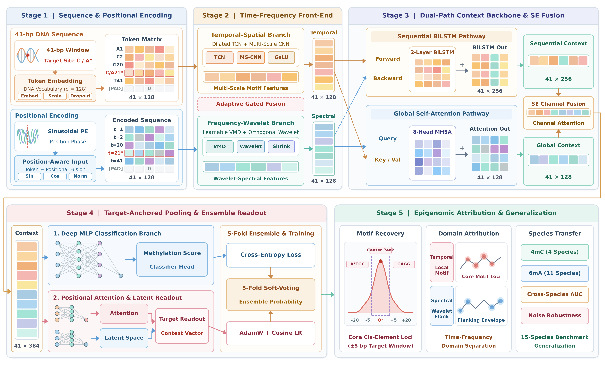

# TF-DualMethyl: A Multi-Resolution Time-Frequency and Dual-Path Deep Learning Framework for Cross-Species DNA Methylation Site Prediction

Official PyTorch implementation, benchmark datasets, and experimental results for **TF-DualMethyl**:

> **TF-DualMethyl: A Multi-Resolution Time-Frequency and Dual-Path Deep Learning Framework for Cross-Species DNA Methylation Site Prediction**  
> Muxi Luo, Yujie Liu, Fang Fang*, and Rao Zeng*  

---

## 1. Overview



**TF-DualMethyl** is an end-to-end, interpretable deep learning framework for cross-species DNA $N^4$-methylcytosine (4mC) and $N^6$-methyladenine (6mA) site prediction from 41-bp primary genomic windows:
- **Stage 1 (Sequence & Positional Encoding):** Token embedding ($d=128$) scaled by $\sqrt{d}$ with deterministic multi-frequency sinusoidal positional encoding.
- **Stage 2 (Multi-Resolution Time-Frequency Front-End):**
  - *Temporal-Spatial Branch:* Three-layer causal dilated Temporal Convolutional Network ($d \in \{1,2,4\}$) followed by a Multi-Scale CNN ($k \in \{3,5,7\}$).
  - *Frequency-Wavelet Branch:* Differentiable rFFT Variational Mode Decomposition (VMD, $K=4$ Wiener bandpass modes) cascaded with multi-scale discrete wavelet transform initialized with orthogonal Haar ($s=2$), Daubechies-2 ($s=4$), and sinusoidal-Gaussian ($s=8$) Quadrature Mirror Filter (QMF) priors and learnable soft-thresholding shrinkage.
  - *Adaptive Gated Fusion:* Three-branch softmax gating dynamically arbitrates positional, temporal-spatial, and frequency-wavelet representations.
- **Stage 3 (Dual-Path Context Backbone & SE Fusion):** Parallel two-layer BiLSTM ($5'\leftrightarrow 3'$ sequential reading-frame continuity) and two-layer 8-head self-attention Transformer encoder, unified via Squeeze-and-Excitation (SE) channel recalibration.
- **Stage 4 (Target-Anchored Attention Pooling & 5-Fold Ensemble):** Learnable sequence attention pooling ($\alpha_1, \dots, \alpha_{41}$) and 5-fold soft-voting ensemble readout.
- **Stage 5 (Multi-Scale Biological Interpretability):** 256-d penultimate feature space projections (t-SNE/UMAP), 41-bp positional attention profiling, cross-species generalization matrices, and single-nucleotide Layer Integrated Gradients (LIG) motif attribution.

---

## 2. Repository Structure

```text
TF-DualMethyl/
├── model.py                         # TF-DualMethyl (Ultimate_Fusion), 4 ablation variants, and baselines
├── dataset.py                       # 41-bp DNA sequence dataset loader & vocabulary encoding
├── train.py                         # Stratified 5-fold cross-validation trainer with per-epoch logging
├── test.py                          # Independent test-set ensemble evaluator (ACC, SN, SP, MCC, AUC, F1)
├── run.py                           # Single-model runner across all 15 species benchmarks
├── run_all.py                       # Master experiment runner (main model + ablations + baselines)
├── run_all.sh                       # One-click server training & evaluation launcher
├── run_cross_transfer.py            # Cross-species generalization evaluator (4x4 4mC & 11x11 6mA)
├── run_probability.py               # Test-set prediction probability extractor
├── generate_table.py                # Aggregator generating summary tables & LaTeX tables
├── baseline/                        # Additional baseline predictor implementations
├── plot/                            # Visualization & interpretability scripts (t-SNE/UMAP, LIG, heatmaps)
├── data/                            # 15 cross-species 4mC (4) and 6mA (11) benchmark datasets (iDNA-MS)
├── results/                         # Complete experimental metrics, logs, and cross-species matrices
└── figures/                         # All 13 manuscript figures & Graphical Abstract
```

---

## 3. Environment Requirements

Install dependencies via `pip`:

```bash
pip install -r requirements.txt
```

- Python >= 3.9
- PyTorch >= 2.0
- NumPy, Pandas, Scikit-learn, SciPy
- Matplotlib, Seaborn, umap-learn

---

## 4. Quick Start: Training & Evaluation

### 4.1 Train and Evaluate TF-DualMethyl on All 15 Datasets
```bash
python run.py --model Ultimate_Fusion --gpu 0
```

### 4.2 Reproduce Full Benchmark Suite (Main Model + 4 Ablations + Baselines)
```bash
bash run_all.sh --gpu 0
```

### 4.3 Cross-Species Generalization Evaluation
```bash
python run_cross_transfer.py --gpu 0
```

### 4.4 Generate Summary Tables and Figures
```bash
python generate_table.py
python plot/plot_comparison_figures.py
python plot/plot_ablation_figures.py
python plot/plot_motif_saliency.py
```

---

## 5. Benchmark Datasets (15 Species, 489,152 Sequences)

All 15 benchmark datasets curated from iDNA-MS (41-bp windows centered at $\text{C}_{21}$ for 4mC or $\text{A}_{21}$ for 6mA, CD-HIT sequence identity $<80\%$) are provided under [`data/`](./data/):
- **4mC (4 species):** *Casuarina equisetifolia*, *Fragaria vesca*, *Saccharomyces cerevisiae*, *Tolypocladium* sp. SUP5-1
- **6mA (11 species):** *Arabidopsis thaliana*, *Caenorhabditis elegans*, *Casuarina equisetifolia*, *Drosophila melanogaster*, *Fragaria vesca*, *Homo sapiens*, *Rosa chinensis*, *Saccharomyces cerevisiae*, *Tetrahymena thermophila*, *Tolypocladium* sp., *Xanthomonas oryzae* BLS256

---

## 6. License

This project is released under the [MIT License](./LICENSE).
